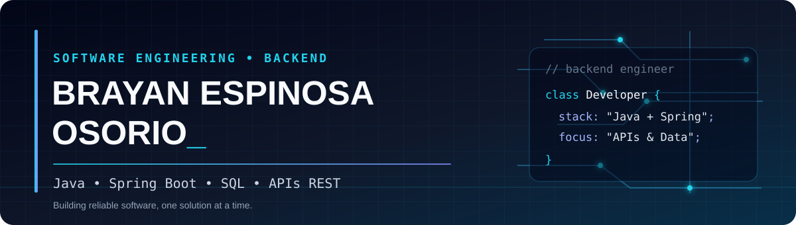
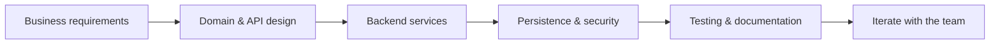

  
  
  

**[View projects](#-featured-projects)** · **[Tech stack](#-tech-stack)** · **[GitHub activity](#-github-activity)** · **[Contact](#-lets-connect)**

---

## 👋 About me / Sobre mí

**Soy Brayan Espinosa Osorio**, desarrollador de software enfocado en **backend con Java y Spring Boot**, integración de bases de datos y construcción de servicios. Disfruto trabajar en equipo, convertir requerimientos en funcionalidades verificables y mantener el código organizado, documentado y fácil de evolucionar.

I focus on **backend development, REST APIs, data persistence and software design**. My public repositories show hands-on team projects across inventory management, sales systems and cultural-event administration.

- **Backend:** Java, Spring Boot, REST, Spring Security, JWT y arquitectura por capas.
- **Data:** SQL, MySQL, PostgreSQL, JDBC, JPA y modelado de datos.
- **Software design:** POO, MVC, separación de responsabilidades, patrones de diseño y manejo de errores.
- **Collaboration:** Git/GitHub, trabajo con equipos, documentación técnica y prácticas ágiles.
- **Currently exploring:** arquitectura hexagonal, testing y mejores prácticas para servicios mantenibles.

> **Lo que puedo aportar a un equipo:** implementación de lógica de negocio, integración de APIs y bases de datos, organización de código y comunicación técnica clara.  
> **What I bring to a team:** backend implementation, database integration, code organization and collaborative delivery.

## ⚡ Tech stack

| Backend & languages | Databases & persistence | Frontend & tooling |
| :---: | :---: | :---: |
|  |  |  |

Technologies used in projects and/or currently being developed; not a claim of equal proficiency in every tool.

## 🧩 Engineering approach

<b>🔎 What I care about when building software</b>

- Clear responsibilities between controllers, services, domain models and repositories.
- Input validation, predictable error handling and secure access controls.
- Consistent data models and reliable persistence.
- Traceable requirements, readable pull requests and useful documentation.
- Learning architecture patterns without adding unnecessary complexity.

---

## 🚀 Featured projects

Verified public collaborative repositories. Project ownership remains with the respective repository owners and teams.

<table>
<tr>
<td width="50%" valign="top">
<h3>📦 LogiTrack — Inventory Platform</h3>

Inventory, warehouse and logistics management application with an authenticated REST API, movement tracking and audit capabilities.

<strong>Engineering highlights:</strong> layered architecture, JWT authentication, PostgreSQL persistence and OpenAPI documentation.

<code>Java 17</code> <code>Spring Boot</code> <code>Spring Security</code> <code>JPA</code> <code>PostgreSQL</code>

<a href="https://github.com/luish-gonzalez/Proyecto_LogiTrack_SpringBoot"><b>↗ Explore code & README</b></a>
</td>
<td width="50%" valign="top">
<h3>📱 TecnoStore — Sales & Stock</h3>

Console system for managing mobile phones, customers, sales and inventory, with business validation and reporting.

<strong>Engineering highlights:</strong> MVC, object-oriented design, JDBC/MySQL persistence, collections and design patterns.

<code>Java</code> <code>MVC</code> <code>MySQL</code> <code>JDBC</code> <code>POO</code>

<a href="https://github.com/luish-gonzalez/Proyecto_TecnoStore_Java"><b>↗ Explore code & README</b></a>
</td>
</tr>
<tr>
<td width="50%" valign="top">
<h3>🎭 CultuVivo — Cultural Events</h3>

Collaborative Python application for cultural event scheduling, artist records and attendee registration.

<strong>Engineering highlights:</strong> role-based workflows, JSON persistence and a Scrum-based team sprint.

<code>Python</code> <code>JSON</code> <code>Scrum</code>

<a href="https://github.com/luish-gonzalez/Proyecto_CultuVivo_LealShirlyGomezAndresEspinosaBrayanGonzalezLuis"><b>↗ Explore code & README</b></a>
</td>
<td width="50%" valign="top">
<h3>🏬 LogiTrack — Warehouse Management</h3>

Additional collaborative Spring Boot repository focused on warehouse management and Java backend development.

<strong>Engineering highlights:</strong> Java application structure and Maven-based project setup, with work on the <code>develop</code> branch.

<code>Java</code> <code>Spring Boot</code> <code>Maven</code>

<a href="https://github.com/luish-gonzalez/Proyecto_SpringBoot_Gestion_Bodegas_Logitrack"><b>↗ Explore repository</b></a>
</td>
</tr>
</table>

## 📈 GitHub activity

 

Stats use third-party renderers and are illustrative of public GitHub activity; they may sometimes be temporarily unavailable.

## 🤝 Let's connect

I'm interested in **backend engineering, Java/Spring Boot projects and collaborative software development**.

  

<strong>⚡ Build • Learn • Collaborate • Improve</strong>

